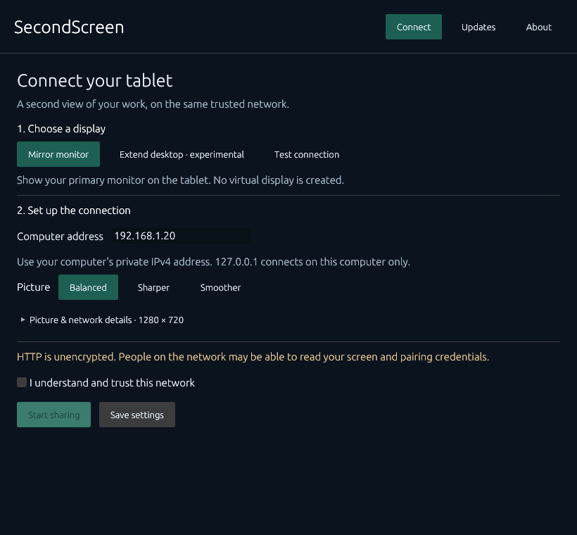
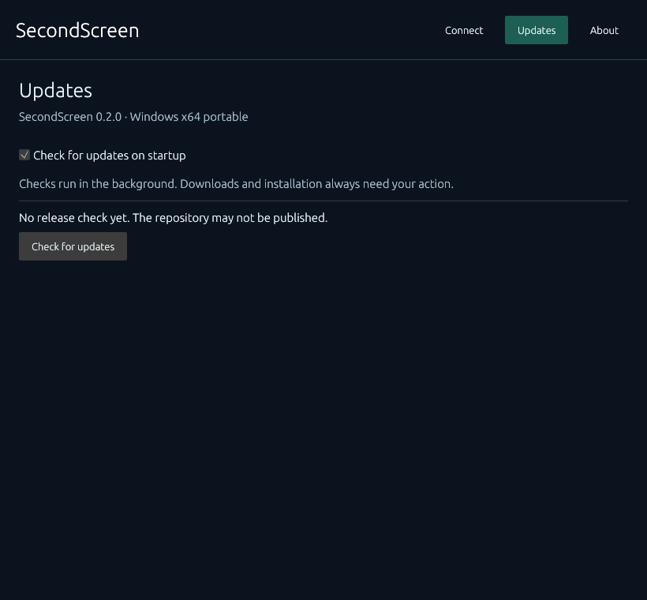

# SecondScreen

An independent Windows host and embedded tablet/browser viewer. Rust, native desktop controls, one portable host EXE, no account or cloud relay. MIT licensed; not affiliated with Duet.

**Version 0.2.0 adds an experimental virtual-display backend and driver sources.** Default builds remain mirroring/synthetic-only. The opt-in backend creates a genuine IddCx monitor after tablet approval and streams that target's surfaces; Windows desktop arrangement stays under your control. The complete driver could not be built here because WDK is absent, so real desktop extension is not yet verified. See [driver build/status](driver/README.md) and [validation](docs/DRIVER_VALIDATION.md).

## What is implemented

- Windows primary-monitor capture through GDI, aspect-preserving scaling, JPEG encoding and authenticated HTTP frame delivery. A moving synthetic source exercises the same encoder and transport without reading the screen.
- Optional IddCx/UMDF source with monitor arrival/departure, owner-file IOCTLs, two-slot D3D11 readback, bounded BGRA frames and a reader watchdog. No driver installation, signing, registration or topology changes are performed by the host/build scripts.
- Embedded responsive viewer with a pairing form, host approval, connection state, full screen, resolution indicator and disconnect. No browser installation, external scripts, fonts or CDN.
- One viewer per host, a random 10-character pairing code, five pairing attempts per minute globally, a 256-bit session token bound to the viewer IP, a fixed approval deadline and idle expiry.
- A focused Connect screen with display choice, picture presets and pairing steps. Exact resolution, JPEG quality, port and 5–20 FPS controls are under Picture & network details. Closing the host stops sharing; no hidden tray sharing is introduced.
- Updates settings with the installed version, manual **Check for updates**, a persistent startup-check opt-out and **Download and install** with progress, digest checking, replacement helper and restart.

**Network limitation:** the viewer uses unencrypted HTTP. Pairing prevents casual unauthorized viewing, but does not protect frames or credentials from network observers or an active attacker. Use a trusted private LAN only. There is no TLS, internet relay, USB transport, remote input or unattended sharing. Do not port-forward this service. The host requires acknowledgment of this limitation before starting.

## Build

Windows x64 is the supported packaging target. Use Rust 1.95 or newer with the MSVC toolchain and the Visual C++ build tools. Node 22+ is used only for the viewer tests; it is not needed by the installed application.

```powershell
cargo fmt --all -- --check
cargo clippy --locked --all-targets -j 2 -- -D warnings
cargo test --locked -j 2
node --test tests/viewer.test.cjs
./scripts/package.ps1 -Offline
```

Omit `-Offline` on a clean development computer that needs dependencies. Cargo is limited to two jobs and repository-local `target` output. Packaging links the MSVC runtime statically and produces `dist/SecondScreen-v0.2.0.exe` and `dist/SHA256SUMS`. The EXE embeds the viewer, not a driver package; ship its license notices too. To build the experimental selector, use `./scripts/package.ps1 -Offline -VirtualDisplay`. It still never opens/installs a driver during compilation.

`./scripts/generate-notices.ps1 -Offline` regenerates the locked Windows dependency inventory and available code/font license texts. The inventory explicitly marks upstream archives missing standalone code-license texts. Resolve those notices and review font attribution before public distribution; this local build is not a publication-ready release.

## Use after manual validation

1. Launch the packaged EXE. Sharing starts off; startup update checking runs in the background unless disabled in **Updates**.
2. In **Connect**, select **Test connection** first. Enter the computer's RFC1918 private LAN IPv4 address. The default `127.0.0.1` is local to the host and cannot be opened on a tablet. IPv6, hostnames and wildcard binding are not supported.
3. Choose a picture preset; detailed controls are optional. Acknowledge the HTTP limitation and click **Start sharing**. Firewall access, if needed, must be configured by the user; the application does not alter firewall rules.
4. On a tablet on the same trusted network, open the exact `http://IP:PORT` address shown. Enter the code within five minutes. Check the requesting IP on the host and click **Approve viewer and start capture**.
5. For mirroring, stop, choose **Mirror monitor**, start again and pair again. Only approval starts capture. Dimensions are limits, not a physical display mode change; aspect ratio is retained without upscaling.
6. Use **Disconnect** in either application to revoke access, or **Stop sharing** to close the listener. The last frame is cleared on disconnect. An abandoned viewer expires after 15 seconds without authenticated requests; a pending request has a 60-second maximum approval window.

Settings are saved by **Save settings** and immediately when changing the startup-update toggle. Storage: `%LOCALAPPDATA%/SecondScreen/settings.json`. Tokens and pairing codes are never persisted. Stream changes apply on the next start. A browser reload requires pairing again.

## Updates and distribution status

The planned canonical repository is [siarheisinelnikau/second-screen](https://github.com/siarheisinelnikau/second-screen). It has **not been published by this task**. A missing repository/release, network error or rate limit is shown as an unavailable check, not as an up-to-date installation. Startup failures remain on the Updates page without a dialog.

Only stable semantic versions and the official Windows x64 asset `SecondScreen-vVERSION.exe` are accepted. A matching SHA-256 checksum entry or valid GitHub asset digest is required, HTTPS redirects stay HTTPS, file size is bounded and the PE architecture is checked. Installation is always initiated by the user. Keep the portable EXE in a writable folder: the application will not elevate. The helper waits for a verified parent process to exit before replacing it, keeps a recovery backup, attempts rollback if replacement/relaunch fails and leaves settings untouched. The installed filename is preserved. See [update design and recovery](docs/ARCHITECTURE.md#portable-updates).

## Extended display status

The `virtual-display` feature implements `ExtendedDisplayProvider` with real device IOCTLs and an independent Windows display source. Its corresponding driver code, INF and WDK project are in [driver](driver/README.md). It reports one monitor only after approval, and removes it on disconnect, file cleanup, power-down or reader timeout. The user chooses Extend in Windows during future device testing; the app never rearranges displays automatically. The [protocol guide](docs/VIRTUAL_DISPLAY.md) and [driver validation record](docs/DRIVER_VALIDATION.md) document what is implemented and what remains untested. A missing driver produces an error, with no mirroring fallback.

## Screenshots

These images render the real shared application components with isolated fixtures in an offscreen CPU test harness. They were produced without a window, computer use, network, user settings or devices. The production host now uses the same CPU rasterizer and presents through softbuffer/Win32 GDI. These captures verify client-area layout, not window chrome, input behavior or idle performance. Real native-window and connected-tablet screenshots remain pending.





Regenerate six bounded fixture views with `./scripts/render-previews.ps1`. The harness shares `src/ui.rs` with the native host, renders four finite frames per image and exits under an external 30-second timeout. It does not start the application workers or call GDI/D3D/device APIs.

## Verification

The synthetic tests cover pairing/approval, token revocation, expiry, request bounds, cross-origin/Host rejection, JPEG encode/decode, the complete in-memory HTTP route and persistent update opt-out. Node tests exercise the viewer's approval gate, Authorization header and frame cleanup with an artificial DOM. A separate loopback TCP integration test is opt-in because this development sandbox denied loopback connections:

```powershell
cargo test --locked --lib loopback_synthetic_transport -- --ignored --nocapture
```

That command uses only loopback and synthetic pixels, never LAN binding or screen capture. Compilation alone does not establish Windows capture, browser compatibility, idle CPU use or installation correctness. See [original mirroring validation](docs/VALIDATION.md), [driver validation](docs/DRIVER_VALIDATION.md), [architecture](docs/ARCHITECTURE.md), [current release-note draft](docs/RELEASE_NOTES_0.2.0.md), and [third-party notices](THIRD_PARTY_NOTICES.md).

The v0.2.0 experimental host package built successfully (8,135,168 bytes). `python scripts/inspect_pe.py dist/SecondScreen-v0.2.0.exe` passed x64 GUI PE/import/digest checks without executing it. Python is an optional development tool. The driver tests separately compile the SDK readback module and verify the actual C++ mailbox output with Rust; this does not replace a complete WDK build/device check.


## Shared updates and CPU host audit

Build this repository beside `rust-auto-updator`: the core is a local path dependency at `../rust-auto-updator/crates/rust-auto-updator`. CI/package environments must provision both siblings; the shared core has not been published to a registry by this change. The host retains its persisted startup opt-out, manual check and explicit Download and install action. Network selection, verification, progress, staging, replacement, rollback and cleanup now use that core. Packages keep `SecondScreen-vVERSION.exe` and `SHA256SUMS`; earlier GitHub digest-only metadata remains supported.

The control window uses egui software rasterization and softbuffer's Win32 GDI path. It creates no OpenGL or DirectX context. The experimental virtual-display driver uses D3D independently for its required capture surfaces. The host sleeps without a repaint deadline, reuses its bitmap for unchanged expose events and suppresses layout/raster/present while minimized. Background pairing and host commands still run. Closing the host stops sharing; there is no tray mode or tray icon to configure.

Original multi-size executable and runtime window icons are now supplied. After packaging, `./scripts/inspect-icons.ps1` loads the EXE as resource data and renders 16–256 pixel icons without executing the application. Optional `SECOND_SCREEN_RENDER_METRICS` writes aggregate logic/layout/raster/present counts on normal exit for later runtime diagnostics.

This audit used source inspection, isolated fixture tests and packaged resource loading. Native-window launch, OS taskbar identity, visible/minimized/restore frame counts, CPU/GPU load and subjective responsiveness remain unverified in this code-only session. Existing real component captures above remain accurate; native host and connected-tablet screenshots still require the separately authorized device/UI validation.
